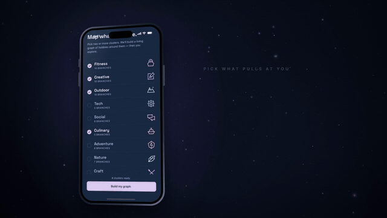

# Aspect Niche: website

[](https://aspectniche.com)

Aspect Niche is a hobby discovery app for iPhone and iPad. Pick what you're
curious about and a living graph of hobbies grows around it; each one comes
with a plan for your first session, places near you picked for a first visit,
and a link to invite friends. Flip the graph and it becomes a record of what
you've done, with your own photos and notes.

[](https://aspectniche.com/#film)

**[Watch the launch film](https://aspectniche.com/#film)** (2:20, narrated, with
captions). The web-encoded film is served from
[`public/film/`](./public/film); every screen in it is the real app.

This repo is [aspectniche.com](https://aspectniche.com): the landing page, the
legal pages, and the pages that open the invitation and date-plan links the app
shares, so anyone can answer one without installing anything.

Built with Next.js, TypeScript and Tailwind CSS. No other runtime dependencies:
the fonts and the film are self-hosted, and the site sets no cookies.

## Where things live

| Path | What it is |
|---|---|
| `src/app/globals.css` | The design system: the app's Midnight palette as tokens, type scale, buttons, header and footer |
| `src/app/_site/` | The shared header, footer, starfield and film constants |
| `src/app/_landing/` | The landing page, one file per section |
| `src/app/_landing/catalogue.ts` | The app's 47 hobbies and 11 clusters, exported from the mobile repo; the map draws exactly these |
| `src/app/_legal/` | The layout Privacy, Terms and Support share |
| `src/app/i`, `p`, `r`, `pr`, `s` | The pages invitation, date-plan, reply and series links open |
| `public/film/` | The launch film (1080p and 720p), its captions, poster, teaser and the app clips the tour plays |
| `public/make/` | Captures of the app's eight themes and six icon sets |

The film's source and archival masters live in the separate
`aspect-launch-film` project. To refresh the web copies after a re-render,
re-encode `out/aspect-niche-launch-1080p.mp4` there (H.264, CRF 24, AAC 160k,
`+faststart`) into `public/film/`, and convert `out/aspect-niche-launch.en.srt`
to WebVTT.

## Run it

```bash
npm install
npm run dev     # http://localhost:3000, no configuration needed
npm run test    # link encoding, invitation art, and the hobby map's layout
```

## Licence

Copyright (c) 2026 Devauntae Norman. All rights reserved. This repository is
public to be read, not reused; see [LICENSE](./LICENSE).
