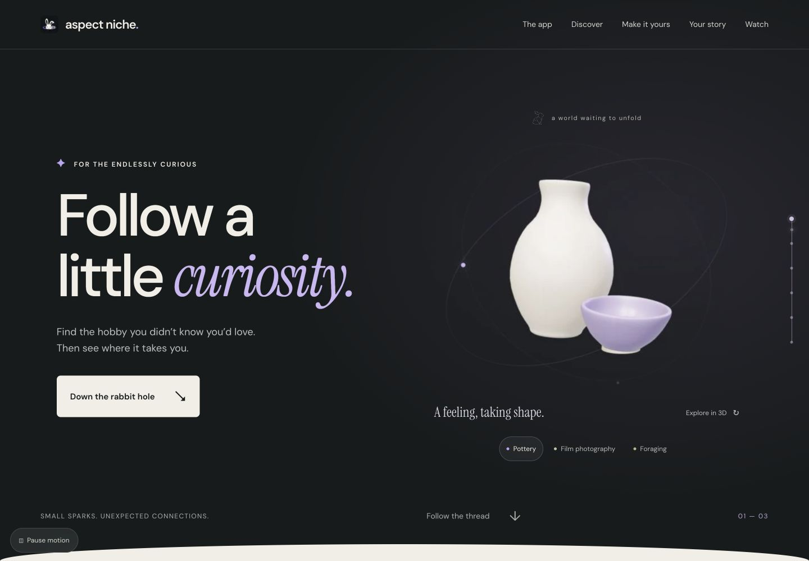
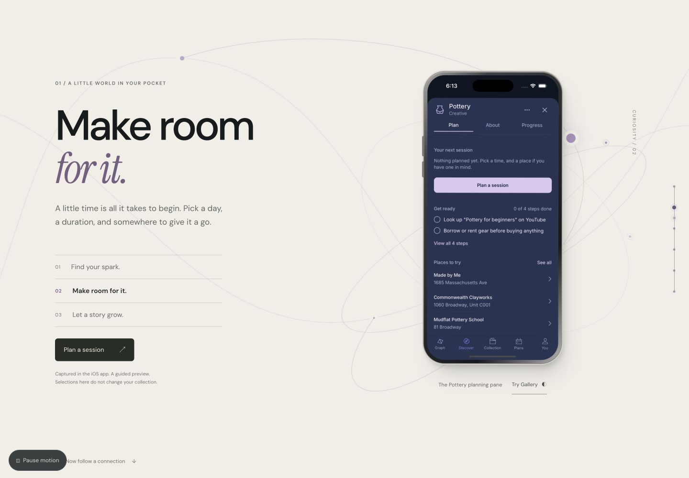

# Aspect Niche — immersive refinement

Implemented on `codex/immersive-refinement`, originally based on web commit `974c9bb` and integrated with the current production branch. Deployment was approved on November 2, 2026. Production is published through the existing GitHub → Vercel integration at [aspectniche.com](https://aspectniche.com). The original checkout remains separate at `../aspect-niche-web`.

## Review the implementation

From `/Users/bigbobby/Projects/aspect-niche-web-immersive`:

```sh
npm run dev -- --port 3007
```

Open `http://localhost:3007`. For the verified production build, run `npm run start -- --port 3008` after `npm run build`.





## What changed

- Kept the rabbit identity, existing typefaces, lilac accents, dark opening, warm Gallery, interactive graph, Memory Walk and captioned launch film.
- Replaced the static statement with a three-chapter app story: discover an interest, make time for it, and begin a personal record. Real iOS screenshots sit in an animated device with working guided-preview hotspots.
- Added a moving point on a constellation path, restrained device depth/rotation, animated chapter typography and a chapter navigation rail. The paper sections enter through broad curved edges. Native document scrolling remains intact.
- Rebuilt pottery, a film camera and a botanical sprig as procedural Three.js models. Ceramic grain, beveled metal, leather, layered optics and curved leaves give each object a distinct material treatment. The models total 28,672 rendered triangles, 14 materials and two 128 px procedural textures.
- Initial loading uses small posters rendered from those exact models. “Explore in 3D” loads the engine on request; “Turn the object” and pointer dragging then rotate it. This avoids shader setup during the initial mobile load. No idle animation loop runs after motion settles, offscreen, or while the document is hidden. Pixel ratio is capped at 1.5.
- Removed the old graph's scroll-triggered collection changes. Explicit preview interaction owns the screen until “Follow scroll again” is chosen. Narrow/short viewports use normal document flow and explicit controls.
- Kept the global motion control, added matching visible/accessibility labels, cancelled interrupted graph/Studio animations, and deferred film loading with `preload="none"`.

## Authentic app evidence

Inspected the running iPhone 16 Pro simulator (iOS 18.6), application bundle `com.aspectniche.app`, and mobile source at commit `92c5b8f`.

The six WebP screens in `public/landing/app-preview` were captured on November 2, 2026. They retain the actual app interface and its five tabs. No UI was painted into them.

| Asset | Simulator capture time | Actual content |
| --- | --- | --- |
| `graph.webp` | 18:08:31 | Midnight graph, connected interests and five navigation tabs |
| `about.webp` | 18:12:52 | Pottery About, collect action, information and resources |
| `plan.webp` | 18:13:10 | Collected Pottery Plan, session entry and preparation steps |
| `session.webp` | 18:13:19 | Session editor: date, time, duration, place and calendar option |
| `progress.webp` | 18:14:45 | Empty Pottery Progress with log/photo/reflection entry points |
| `gallery.webp` | 18:16:52 | The real Gallery graph theme |

The native collection and theme changes used to inspect these states were restored. No session was saved. The screenshot walkthrough is explicitly labeled as a guided preview: it does not edit a real collection or save a plan. Form fields visible in the session capture are illustrative, not live web form controls. The existing Memory Walk continues to label its memories as samples.

Relevant mobile implementation inspected: `src/app/(tabs)/graph.tsx`, `ActivityDetailHost.tsx`, `DetailSheet.tsx`, `StudioPanel.tsx`, `SessionScheduler.tsx`, `saved.tsx`, `board.tsx` and `MemoryWalk.tsx`. The website does not introduce clubs, AI graph creation, fabricated progress or app-store availability claims.

## Reference study

Each reference was opened and interacted with in the connected browser. These are visual observations, not claims about their internal libraries.

| Reference | Distinctive technique observed | Original adaptation here |
| --- | --- | --- |
| [Quynh Cao](https://quynh.moe) | A quiet index maintains orientation while stacked images become larger scenes | Keep navigation legible while one object or app screen takes visual focus |
| [Job Hunt](https://jobhunt.asmcleod.com) | A spatial nucleus connects to application nodes; camera travel reveals the network | A sparse constellation traveler and chapter rail, without a mandatory intro or a dense wall of labels |
| [A24](https://a24.raviklaassens.com) | Dimensional discs, materially convincing surfaces and continuous object orientation | Bespoke hobby objects, measured rotation and restrained device perspective |
| [8am Showcase](https://showcase.8am.com) | Scroll reveals a narrative, with deeper interactive feature walkthroughs | Three focused app chapters with optional direct exploration |

No reference assets, layouts or source code were copied.

## Verification

- `npm test`: **85 tests across 13 files passed** after integration with production commit `13ea49c`. New regression tests protect manual screen ownership, explicit return to scroll and invalid/bounded scroll measurements.
- `npm run lint`: **zero errors**; four existing unused-variable warnings remain in `src/app/i/card/route.tsx`, `src/app/support/page.tsx` and the production branch's `src/lib/rsvpApi.test.ts`.
- `npm run build`: **passed**, using the lockfile's Next.js 16.4.3. Existing Edge Runtime deprecation/static-generation warnings remain on product routes.
- `git diff --check`: passed.
- Connected browser review at 1440×1000, 1280×720, 390×844 and 320×700. Measured document width matched viewport width at 390 and 320 px.
- Verified real preview navigation from About → collect → Plan → session editor → close, Progress/Plan switching, Gallery/Midnight capture switching, manual choice preservation during scroll, and explicit return to the scroll sequence.
- Verified the constellation traveler's rendered coordinates change with scrolling, the chapter changes at the planned thresholds, and Pause motion stops scroll-driven chapter changes.
- Verified static poster selection, live 3D activation/model switching, existing graph collect/flip behavior, all three Studio appearances, and Memory Walk play/next/end behavior.
- No production console errors were observed in the inspected flows. A development-only image sizing warning appeared during earlier iterations; the new hero image's explicit aspect treatment was corrected.

The landing-page scope contains all UI changes. No product route, shared root layout, global stylesheet, backend, deep-link, security-header or native app source was changed. The only runtime dependency added is pinned `three@0.180.0` with matching development types.

## Limits

These checks do not establish field INP, sustained frame rate, thermal behavior or battery use. Physical iPhone Safari, VoiceOver and live OS reduced-motion preference switching were not exercised. The pause control and reduced-motion source paths were reviewed; the explicit pause behavior was exercised in the browser. WebGL-unavailable/context-loss fallback paths were implemented but not forced in this browser session. Live 3D startup on a throttled physical device remains a separate performance check; the page intentionally stays useful without activating it.

## Production performance measurements

Lighthouse 13.6.0, local production server, headless Brave/Chromium. Mobile uses the standard simulated throttling profile at 412×823; desktop uses the desktop preset at 1350×940. Single lab samples, not field results. No live 3D activation during initial-load audits.

| Mode | Performance | Automated accessibility | LCP | TBT | CLS | Transfer |
| --- | --- | --- | --- | --- | --- | --- |
| mobile | 84 | 100 | 4.22 s | 78 ms | 0.00000 | 509 KiB |
| desktop | 99 | 100 | 0.85 s | 0 ms | 0.00001 | 509 KiB |

The earlier eager-WebGL draft scored 64 for mobile performance with 5,280 ms TBT. Moving engine startup behind explicit interaction removed that initial blocking cost. The final mobile LCP remains about 4.2 seconds and needs further optimization before claiming a sub-2.5-second load budget. Scores vary between runs. These local results are not a controlled comparison to the deployed website. Raw reports and a machine-readable summary are in `evidence/`.
